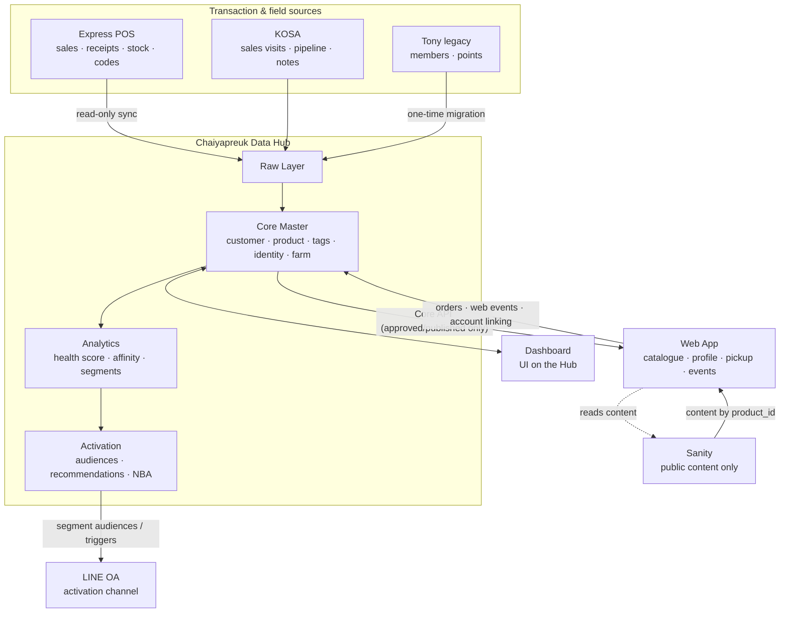
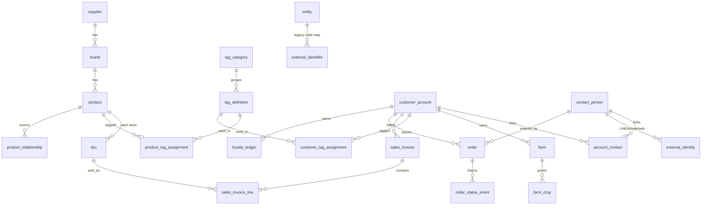

# Chaiyapreuk Data Hub — Architecture Deliverable (Round 1)

- **Date:** 2026-07-27
- **Status:** Design only — **no code changes** (per brief §28). For discussion & sign-off before implementation.
- **Companion to:** the PM's "Data Architecture and System Context" brief (the target design). This document does the **current-state review + reconciliation + gaps + migration/API plan + risks** the brief asks for in §28.

## 0. Scope & method (what I could and couldn't see)

I directly reviewed the parts I built: the **Web App repo** and **Sanity**. The other systems — **Express POS, the Dashboard's backend DB, KOSA, Tony** — I know **only from your brief's prose**; I have not seen their real schemas/exports. So:

- The **current-state map for Web/Sanity is precise**.
- For Express/Dashboard/KOSA/Tony, the map is **"as described"** — I need their real schemas/sample exports to finalize the ERD's external edges and the migration mapping (listed in §11).

---

## 1. Current-State Data Map (what exists today)

| Data | Where it lives NOW | Notes / conflict with target |
|---|---|---|
| **Products (565)** | **Sanity** documents (flat) | I imported them; Sanity is the *de-facto* product master today. Target says Data Hub should be master → **migrate**. |
| Product fields | Sanity `product`: name, brand, supplier, `category`(raw กลุ่ม), `mainCategory`(7 buckets), shortDescription, description, activeIngredient, formulation, usageRate, `code`, photos[], bestSeller, campaignTags[], visible | Rich, but **flat** — no Product Family/SKU split. |
| Product key | Sanity `_id = "product-<sha1(supplier|name)>"`; web cart/compare key = that `_id` | **Violates** brief §5/§26 ("no name / no composite-string keys"). Must re-key to Data Hub `product_id`/`sku_id`. |
| "code" field | the Sheet's per-supplier sequence number | **Not** the real Express product code (restarts per supplier, non-unique). Real code must come from Express sync + mapping. |
| Category | `mainCategory` = 7 auto-classified buckets | A simplification → should become a `PRODUCT_TYPE` tag in the Tag Dictionary. |
| Public content (banner, article, product photo, public description) | **Sanity** | ✅ Aligns with target (Sanity = content). Keep. |
| Orders | **Not modeled** — web builds a text message and pushes to the staff **LINE group** via Messaging API | No `order` entity, no status history. Target wants `order` + `order_status_event`. |
| Cart / compare | Browser **localStorage** | Fine (ephemeral UI state). |
| Customer / points / tier / tags / farm / identity | **Not built** — the profile page shows **mock data** (`loyalty.ts`) | All to be built in the Data Hub. |
| Web behavioral events | **None** | Target wants event tracking; nothing collected yet. |
| Express / KOSA / Tony / Dashboard-backend | **External, not connected, schemas unseen** | Need real schemas/exports (see §11). |

**Web tech now:** Next.js (Vercel) → reads Sanity via `next-sanity` (public dataset); LINE Messaging API for order push; no database/Supabase; no auth.

---

## 2. Gap Analysis — key reconciliations (current → target)

These are the decisions that matter most; each becomes migration work:

1. **Product master moves Sanity → Data Hub.** Sanity keeps *only* public content (photos, public description, banners, articles), referenced by `product_id`. Everything canonical (codes, tags, stock, price, relationships) lives in the Hub.
2. **Re-key the catalogue.** Replace the `sha1(supplier|name)` `_id` with Hub `product_id`/`sku_id`. Keep a mapping so existing links/localStorage don't hard-break.
3. **Introduce Product Family + SKU.** Today's flat products → `product` (family) + `sku` (pack sizes). I can seed the split from the existing base-name heuristic (e.g., อโทนิค 0.1/0.5/1/5L → 1 family, 4 SKUs) **with human review**.
4. **Real Express codes.** The current `code` is unreliable; `express_product_code` / `express_customer_code` come from the Express sync and live in the mapping table — never as primary keys.
5. **`mainCategory` → Tag.** Fold the 7 buckets into `PRODUCT_TYPE` tags under the Tag Dictionary (keeps the nice catalogue filter, but governed).
6. **Model orders.** Add `order` + `order_status_event` (pickup/delivery status history) — the current LINE push becomes one notification step, not the record.
7. **Identity layer.** Add `contact_person` + `external_identity` (LINE/phone/web) — none exists today.

---

## 3. Target System Architecture (reconciled)

**Layers (brief §4):** Raw (immutable source copies, audit/reprocess) → Core (clean/normalized/linked master; the only layer other systems read via API) → Analytics (derived scores, dated & versioned) → Activation (ready-to-use audiences, recs, NBA, notification queue).

**The Dashboard's backend = the Data Hub.** The Dashboard is a UI; the Hub is the system. *(Open question in §11/§12: does a DB already exist behind today's Dashboard? If so we extend it as the Hub rather than build a new one.)*

---

## 4. Source-of-Truth Matrix (+ current location + action)

| Data | Source of Truth (target) | Where it is NOW | Action |
|---|---|---|---|
| Sales txns, receipts, real price, stock (phase 1) | Express POS | Express (unconnected) | Build read-only sync |
| Legacy Product/Customer codes | Express POS | Express + (unreliable copy in Sanity) | Map via `external_identifier` |
| Customer Master | Data Hub | none (mock) | Build |
| Product Master + Tags + Farm | Data Hub | Sanity (partial, flat) | Migrate + restructure |
| Sales visits / pipeline / notes | KOSA | KOSA (unconnected) | Link by `customer_account_id` |
| Public content | Sanity | Sanity | Keep (content only) |
| Order/Pickup + status | Web App / Data Hub | LINE text only | Build `order` + events |
| Points / Tier | Loyalty Ledger (Data Hub) | mock | Build ledger |
| Segments / recs / scores | Data Hub (Analytics/Activation) | none | Build |
| LINE messaging | LINE OA | partial (order push live) | Extend (segments/transactional) |
| Web behavior | Web tracking → Data Hub | none | Build (start ASAP) |
| Tony legacy | Migration source only | Tony | Export → migrate → retire |

---

## 5. Proposed ERD (core layer)

*(Two distinct mapping tables — see §7: `external_identifier` = internal entity ↔ legacy **system codes** (Express/Tony); `external_identity` = **person** ↔ LINE/phone/web accounts.)*

---

## 6. Table definitions

Your brief's table specs (§6, §7, §10–§23) are **accepted as canonical** — I won't restate them. Refinements/additions I recommend:

- **Add `web_event`** (event_id, session_id, contact_id nullable, anon_id, event_type, entity_type, entity_id, metadata jsonb, occurred_at) — start collecting now.
- **Add `notification_queue`** (queue_id, contact_id, channel, template, payload, status, scheduled_at, sent_at) for LINE transactional + campaign sends.
- **Keep both** `external_identifier` (entity↔legacy code) and `external_identity` (contact↔LINE/phone/web) — they solve different problems; the brief includes both, good.
- **`sku`**: keep price/stock as **synced snapshots from Express** with `synced_at` (Express remains SoT; Hub caches for display — never the master).
- **Loyalty**: `loyalty_ledger` only; balance is a **view/derived**, never stored raw (brief §22 — agreed).
- Every master table carries the audit columns (brief §25).

---

## 7. Identity Mapping Strategy

**Internal stable IDs** for every entity (UUID or prefixed `CUST-…`, `SKU-…`). Never phone/name/composite as PK (brief §5/§26).

**Two mapping mechanisms:**
- `external_identifier` — internal entity ↔ **legacy system code**. e.g. `SKU-000001 ↔ EXPRESS:011-4301-01-3`, `CUST-000345 ↔ EXPRESS:C000345`, `… ↔ TONY:<id>`. Never delete Express codes (reconciliation/audit).
- `external_identity` — **contact_person** ↔ `{PHONE, LINE, WEB_APP, KOSA, TONY}` with `verification_status`.

**Login → identity (from our Phase-3 decisions, folded in):**
- Web login via **LINE** *or* **phone-OTP** — either alone is enough; open registration (unknown phone/LINE → create a new `contact_person`, and a `customer_account` if none links yet).
- Login resolves/creates `external_identity` for that contact. Linking **both** methods is optional → pushed via campaign. **LINE-only accounts show no POS points/history until a phone is linked** (POS keys on phone/customer_code).
- **Household sharing** (brief §10.3): one Express `customer_code` ↔ one `customer_account` with **multiple `contact_person`** via `account_contact` (roles/permissions). "Shared household" is a *derived flag*, not a tag.

---

## 8. Product Tagging Workflow (governed)

- `tag_category` (color lives HERE) → `tag_definition` (namespaced `tag_code`, `tag_id` is the key) → `product_tag_assignment` (evidence_text, source, `assertion_type` EXPLICIT/INFERRED/DERIVED/HUMAN_VERIFIED, confidence, review_status).
- **Claude workflow:** source text → suggest tags **from the dictionary only** (never invent tag names) → schema + conflict validation → **human review** → APPROVED → PUBLISHED. Web/Analytics/Recs use **published only**.
- The current `code|tag|color` CSV = **import prototype**, migrated into the dictionary (not the production schema).
- **Hard guardrail (brief §9/§26):** Claude must NOT invent active ingredient, %, N-P-K, FRAC/IRAC/HRAC, registration no., usage rate, PHI, warnings — store raw + source document + evidence, human-verify. Claude may propose *commercial/benefit* tags but must mark EXPLICIT vs INFERRED. *(This matches my existing rule from CLAUDE.md.)*

---

## 9. Data Migration Strategy (no data loss)

1. **Express** — build a **read-only Integration Service** (on-prem agent or scheduled export reader; **never** internet-expose Express, never web→Express direct): land into `raw_express_*` → normalize to core → `sync_log`, incremental, idempotent (upsert by `external_identifier`). Never mutate raw.
2. **Current Sanity products** — migrate master fields → Hub `product`/`sku`; **keep Sanity for public content**, re-referenced by `product_id`; retain a `sha1_id → product_id/sku_id` map so live web links/carts survive.
3. **Product Family/SKU split** — seed from the base-name heuristic already in the web app; **human-review** the groupings in the Dashboard's Data Review Center.
4. **Tony** — export members/points/mapping → `raw_tony_*` → `customer_account`/`contact_person`/`loyalty_ledger`; keep `TONY` external_identifier; retire Tony after.
5. **Tags** — import the CSV into the dictionary as AI-suggested → review → publish.
6. Keep **all** legacy codes forever (reconciliation/audit).

---

## 10. API & Integration Plan (contracts)

- **Express Integration Service → Hub**: batch/incremental, server-side only. (Contract depends on Express access method — §11.)
- **Hub Core API (read) → Web/Dashboard/LINE**: e.g. `GET /catalogue`, `/product/:id`, `/customer/:id/profile`, `/customer/:id/orders`, `/recommendations?context=…`. Serves **approved/published** tags + **published** content only.
- **Web App → Hub (write)**: `POST /orders` (pickup request), `POST /events` (batch web events), `POST /account/link` (LINE/phone verification).
- **Sanity → Web**: content by `product_id`; Sanity webhook → on-demand revalidate (already live for the current site).
- **LINE OA**: Hub builds a **segment audience snapshot** → push via Messaging API; transactional (receipt/points/status) triggered by Hub order/loyalty events.
- **KOSA ↔ Hub**: sync activities/visits/notes keyed to `customer_account_id`/`contact_id`.

---

## 11. What's buildable NOW vs what needs you

**Buildable now (no external dependency, low risk, reversible):**
- Stand up the **Data Hub (Supabase)** with the Core schema (master + identity + tags + order + loyalty ledger + web_event).
- **Web event tracking** (`product_viewed`, `searched`, `compared`, …) — start collecting immediately so future recommendations have data.
- **Migrate Sanity product master → Hub**; restructure Sanity to content-only + `product_id` refs; re-key the web.
- **Product Family/SKU split** (from existing data, human-reviewed).
- **Tag Dictionary + review workflow** (from your CSV).
- **Web login scaffolding** (Supabase Auth phone-OTP + LINE Login) — identity layer.
- **Order/Pickup request model + status history** (web side).

**Blockers — I need these from you:**
1. **Express access method** (API? scheduled CSV/Excel export? on-prem DB read via an agent?) **+ a sample export/schema** of invoice, invoice_line, customer, product. *(This is the #1 unblocker for sales facts, points, receipts, order history.)*
2. **Does a database already exist behind the current Dashboard?** Its tech + schema. **Critical:** if yes, we extend it as the Hub (don't duplicate master data). If no, we build the Hub fresh.
3. **Tony export** (customers/members/point balance + history/mapping).
4. **KOSA** schema/API + how it keys customers.
5. **The Product Tags CSV** (`tag-template-product-tagged.csv`) — send it and I'll build the dictionary + migration.
6. **SMS OTP provider** (I recommended Twilio Verify / Thai gateway) + a **LINE Login channel**.

---

## 12. Risks & Open Issues

- **Dashboard-backend ownership** — the biggest one. If a DB already backs the Dashboard, we must decide extend-vs-rebuild to honor "one owner per master data" (§26).
- **Express sync mechanism** determines whether "instant points/receipt after a storefront sale" is truly instant. Desktop Express usually means **near-real-time via an agent/polling**, or a staff "confirm" trigger — not a native push.
- **Identity resolution** — Express `customer_code` is household-shared; matching → contacts → LINE/phone needs dedupe/merge + review (risk of duplicate profiles until linked; the "link both" campaign helps).
- **Family/SKU split accuracy** — heuristic seed needs human review.
- **Re-keying** the live web from Sanity `_id` → Hub IDs without breaking existing links/localStorage carts.
- **PDPA** — customer notes, phone, LINE id, credit info need role-based access + consent; don't collect PII without a business purpose (§25).
- **Program size** — this is multi-quarter (your Phase 0→4). The working web app (catalogue/order/LINE/About) must keep running throughout; migration is incremental.

---

## 13. Recommended immediate next step

The single highest-leverage unblocker is a short working session on **(1) Express access + a sample export** and **(2) whether a Dashboard DB already exists (+ its schema)**. Those two decide the Hub foundation and the whole migration.

**In parallel, with zero risk, I can start now on:** the Data Hub Core schema, **web event tracking** (begin data collection immediately), and the **Tag Dictionary** from your CSV — all additive and reversible.

> This is **Round 1**. I'll refine the ERD, table defs, and migration mapping once I see the real Express / Dashboard / Tony / KOSA schemas. Per §28, no code until we've aligned on current + proposed state.
